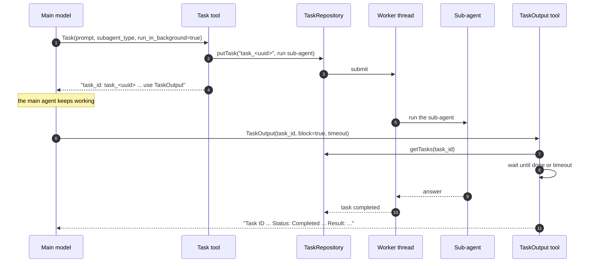
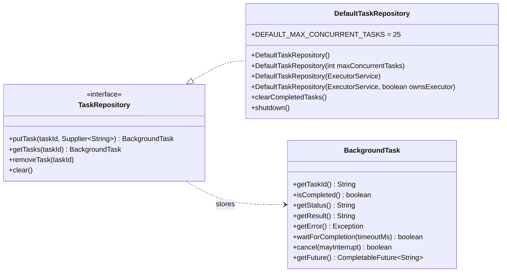

# Background Tasks

A sub-agent normally runs inside the `Task` call: the main agent waits for its answer. With `run_in_background: true`, the `Task` tool starts the sub-agent on another thread and returns a **task ID** at once. The main agent keeps working and later collects the answer with the `TaskOutput` tool.

Use it for long jobs (a full test run, a broad search) that the main agent does not need right away. For how delegation works in general, see the [Overview](TaskTools.md).

## Wiring

Background tasks need two tools that share one `TaskRepository`: `Task` puts tasks in it, and `TaskOutput` reads them back.

```java
TaskRepository taskRepository = new DefaultTaskRepository();

ToolCallback taskTool = TaskTool.builder()
    .subagentTypes(ClaudeSubagentType.builder()
        .chatClientBuilder("default", chatClientBuilder.clone())
        .build())
    .taskRepository(taskRepository)          // the same repository...
    .build();

ToolCallback taskOutputTool = TaskOutputTool.builder()
    .taskRepository(taskRepository)          // ...in both tools
    .build();

ChatClient chatClient = chatClientBuilder
    .defaultToolCallbacks(taskTool, taskOutputTool)
    .build();
```

!!! warning "Share the repository"
    `TaskTool.builder()` creates its own `DefaultTaskRepository` when you give it none, and `TaskOutputTool.builder()` requires one. If the two tools hold different repositories, every `TaskOutput` call answers "No background task found".

## How it works



1. The model calls `Task` with `run_in_background: true`.
2. The tool stores a new task under the ID `task_<uuid>` and returns that ID right away.
3. A worker thread runs the sub-agent exactly as a normal call would, [sub-agent memory](SubagentMemory.md) included.
4. The model calls `TaskOutput` with the ID. By default it waits up to 30 seconds for the task to finish, then reports its status and, if done, its result or error.

## The `TaskOutput` tool

| Parameter | Required | Meaning |
|-----------|----------|---------|
| `task_id` | yes | The ID the `Task` tool returned. |
| `block` | no | `true` (default): wait for the task to finish. `false`: report the current status at once. |
| `timeout` | no | How long to wait, in milliseconds. Default 30 000; at most 600 000 (10 minutes). |

The answer has a `Status` line, which is `Running`, `Completed` or `Failed: <message>`. It is followed by the `Result`, the `Error` (with its cause), or "Task still running...". A task still running after the timeout can be asked for again.

```text
Task ID: task_3f2a...
Status: Completed

Result:
All 214 tests passed.
```

## Task repository



### `DefaultTaskRepository`

The default repository keeps tasks in memory and runs them on its own thread pool:

- At most 25 tasks run at once (`DEFAULT_MAX_CONCURRENT_TASKS`); more wait in a queue for a free thread. `new DefaultTaskRepository(n)` sets another cap.
- Idle threads end after a minute, so an idle repository holds no threads.
- `new DefaultTaskRepository(executorService)` runs tasks on your executor instead, and leaves its lifecycle to you.
- Finished tasks stay in the repository until removed. Call `clearCompletedTasks()` from time to time in a long-running application, and `shutdown()` when you are done with a repository that owns its pool.

!!! note "Things to watch"
    - **Queued tasks wait.** When the pool is full, a new task waits for a free thread. A background task that waits for another background task's result can then wait forever.
    - **No thread-local context.** Background tasks run on the pool's threads, without the calling thread's thread-locals (security context, MDC, request scope). If your sub-agents or your `SessionService` rely on them, pass an `ExecutorService` that copies that context to its tasks.

### A custom repository

Implement `TaskRepository` to keep tasks somewhere else or run them another way, for example on a distributed queue:

```java
public class QueueTaskRepository implements TaskRepository {

    @Override
    public BackgroundTask putTask(String taskId, Supplier<String> taskExecution) {
        CompletableFuture<String> future = CompletableFuture.supplyAsync(taskExecution, myExecutor);
        BackgroundTask task = new BackgroundTask(taskId, future);
        this.tasks.put(taskId, task);
        return task;
    }

    @Override
    public BackgroundTask getTasks(String taskId) {
        return this.tasks.get(taskId);
    }

    @Override
    public void removeTask(String taskId) {
        this.tasks.remove(taskId);
    }

    @Override
    public void clear() {
        this.tasks.clear();
    }
}
```

`taskExecution` is the whole sub-agent run: calling `get()` on it runs the sub-agent and returns its answer.

## Related documentation

- [Overview](TaskTools.md), [Claude Sub-Agents](ClaudeSubagents.md), [Sub-Agent Memory](SubagentMemory.md)
- [AutoDreamService](AutoDreamService.md): reuses this background infrastructure for its asynchronous cycles
