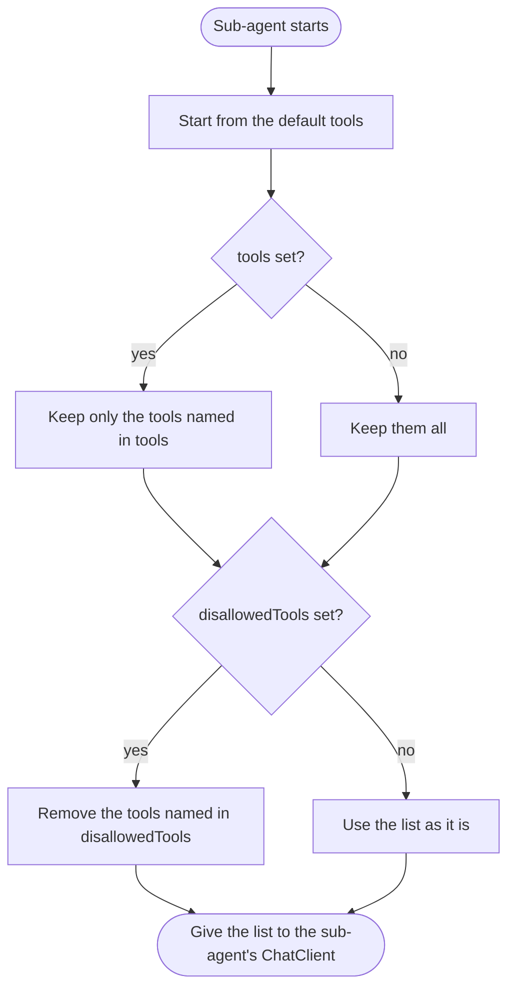
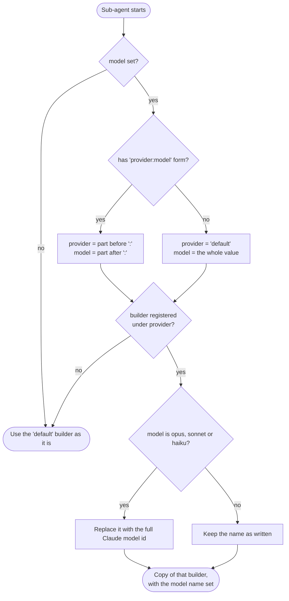

# Claude Sub-Agents

The **Claude** kind is the built-in kind of sub-agent. A Claude sub-agent is defined by a Markdown file with YAML front matter, in the format [Claude Code](https://code.claude.com/docs/en/sub-agents#supported-frontmatter-fields) uses. It runs locally as a Spring AI `ChatClient`, on any model provider Spring AI supports (the name comes from the file format, not from the model).

This page covers the four built-in sub-agents, writing your own, and choosing their tools, model and skills. For how delegation works in general, start with the [Overview](TaskTools.md).

## Registering the Claude kind

`ClaudeSubagentType.builder()` builds the `SubagentType` for Claude sub-agents. Registering it with the `Task` tool also registers the four built-in sub-agents.

```java
SubagentType claude = ClaudeSubagentType.builder()
    .chatClientBuilder("default", chatClientBuilder.clone())   // required
    .chatClientBuilder("openai", openAiChatClientBuilder)       // optional: more providers
    .skillsDirectories("/path/to/skills")                       // optional: skills to preload
    .build();

ToolCallback taskTool = TaskTool.builder()
    .subagentTypes(claude)
    .subagentReferences(ClaudeSubagentReferences.fromRootDirectory(".claude/agents"))  // your own
    .build();
```

| Builder method | What it does |
|----------------|--------------|
| `chatClientBuilder(name, builder)` | Registers a `ChatClient.Builder` under a name. `"default"` is required. Other names act as providers for `model: <name>:<model>` (see [Choosing the model](#choosing-the-model)). The name `"webfetch"`, when present, is used for the `WebFetch` tool's own summarizing calls instead of `"default"`. |
| `chatClientBuilders(map)` | The same for several names at once. |
| `skillsDirectories(dir)` / `skillsDirectories(list)` | Directories to look up [preloaded skills](#preloading-skills) in. |
| `skillsResource(resource)` / `skillsResources(list)` | The same, from Spring `Resource`s. They must be files on disk: a resource inside a JAR fails. |
| `braveApiKey(key)` | Adds the `WebSearch` tool. When not called, the builder reads the `BRAVE_API_KEY` environment variable. The key must not be `null`, so call this only when you have one. |
| `sessionService(service)` | Lets sub-agents keep their transcript. See [Sub-Agent Memory](SubagentMemory.md). |
| `sessionAdvisors(advisors)` | The same, with session advisors of your choice (compaction, turn status). See [Choosing the sub-agents' session advisors](SubagentMemory.md#choosing-the-sub-agents-session-advisors). |

## Built-in sub-agents

| Name | Use it for | Tools |
|------|------------|-------|
| `general-purpose` | Research and multi-step tasks, including code changes. Good when the main agent is not sure a search will hit in the first few tries. | All [default tools](#the-default-tools) |
| `Explore` | Finding files, searching code, answering questions about a codebase. The caller asks for a thoroughness level: `quick`, `medium` or `very thorough`. | All default tools |
| `Plan` | Designing an implementation plan: critical files, step-by-step approach, trade-offs, risks. | `Bash`, `Glob`, `Grep`, `Read`, `WebFetch`, and `WebSearch` with a Brave key |
| `Bash` | Running commands: git, builds and tests, package managers, Docker. | `Bash` only |

The definitions are in the library at `classpath:/agent/*_SUBAGENT.md`.

!!! note "Read-only is an instruction, not a restriction"
    `Explore` and `Plan` are told by their system prompts never to change files. `Explore` still has `Write`, `Edit` and `Bash`, and `Plan` has `Bash`, so they could change files if the model ignored its instructions. If you need a hard guarantee, write your own sub-agent whose `tools` list leaves those out.

## The default tools

Every Claude sub-agent can choose from this set. The names are the ones to use in `tools` and `disallowedTools`.

| Tool name | From | Does |
|-----------|------|------|
| `Read`, `Write`, `Edit` | [FileSystemTools](FileSystemTools.md) | Read, create and change files |
| `Grep` | [GrepTool](GrepTool.md) | Search file contents |
| `Glob` | [GlobTool](GlobTool.md) | Find files by pattern |
| `Bash`, `BashOutput`, `KillShell` | [ShellTools](ShellTools.md) | Run shell commands, read background output, stop them |
| `WebFetch` | [SmartWebFetchTool](SmartWebFetchTool.md) | Fetch a web page and summarize it |
| `TodoWrite` | [TodoWriteTool](TodoWriteTool.md) | Keep a task list |
| `WebSearch` | [BraveWebSearchTool](BraveWebSearchTool.md) | Web search; only with a Brave API key |

!!! warning "Sub-agent tools are not sandboxed"
    These tools are built with their defaults: the file tools may access any path the JVM can, and `Bash` runs on the host through `LocalExecBackend`. A [Workspace or ExecBackend](WorkspaceAndExecSPI.md) you configure for your main agent does **not** reach its Claude sub-agents. Keep this in mind before giving the `Task` tool to an agent you meant to confine.

## Writing your own sub-agent

A sub-agent is one Markdown file. The front matter configures it; the body is its system prompt.

```markdown
---
name: code-reviewer
description: Expert code reviewer. Use proactively after writing or modifying code. Focuses on code quality, security, and best practices.
tools: Read, Grep, Glob, Bash
model: sonnet
---

You are a senior code reviewer with expertise in software quality and security.

**When invoked:**
1. Run `git diff` to see recent changes
2. Focus on the modified files
3. Check the surrounding code for context

**Review checklist:**
- Clarity, naming, duplication
- Error handling
- Security: exposed secrets, injection, XSS

**Output:** clear, actionable feedback with file references and line numbers.
```

The `description` matters most: the main model reads it in the `Task` tool's description to decide when to use this sub-agent. Say what it does and when to use it. Words like "use proactively" make the main model call it without being asked.

### Front matter fields

| Field | Required | Meaning |
|-------|----------|---------|
| `name` | yes | The name the main model passes as `subagent_type`. Must be unique among all registered sub-agents, built-ins included. |
| `description` | yes | When and why to use this sub-agent. Shown to the main model. |
| `tools` | no | Comma-separated tool names to allow. Omitted: all [default tools](#the-default-tools). |
| `disallowedTools` | no | Comma-separated tool names to remove, applied after `tools`. |
| `model` | no | `model`, or `provider:model`. Omitted: the `"default"` builder's model. See [Choosing the model](#choosing-the-model). |
| `skills` | no | Comma-separated skill names to [preload](#preloading-skills) into the system prompt. |
| `permissionMode` | no | Parsed for compatibility with Claude Code, but not supported: any value other than `default` only logs a warning. |

Names in `tools` that are not in the default set (for example `AskUserQuestion`) are ignored.

### How the tool list is built



So `tools: Read, Grep, Glob` gives exactly those three, and `disallowedTools: Write, Edit, Bash, BashOutput, KillShell` gives everything else.

## Loading your sub-agents

`ClaudeSubagentReferences` turns files into `SubagentReference`s for `TaskTool.builder().subagentReferences(...)`:

```java
// Every *.md file under a directory, subdirectories included
List<SubagentReference> refs = ClaudeSubagentReferences.fromRootDirectory(".claude/agents");

// Several directories
List<SubagentReference> refs = ClaudeSubagentReferences.fromRootDirectories(List.of(
    "src/main/resources/agents",
    System.getProperty("user.home") + "/.claude/agents"));

// Spring resources: a directory or a single file, which must be on the file system
@Value("${agent.tasks.paths}") List<Resource> agentPaths;
List<SubagentReference> refs = ClaudeSubagentReferences.fromResources(agentPaths);
```

A definition packaged inside a JAR cannot be read through `getFile()`. Reference it by URI instead; the resolver loads `classpath:`, `file:` and absolute paths:

```java
new SubagentReference("classpath:/agents/code-reviewer.md", ClaudeSubagentDefinition.KIND)
```

## Choosing the model

The `model` field picks both the `ChatClient.Builder` (the provider) and the model name.



Examples, with builders registered as `default` (Anthropic), `openai` and `ollama`:

| `model:` | Provider | Model sent |
|----------|----------|------------|
| *(omitted)* | `default` | the builder's own model |
| `haiku` | `default` | the full Claude Haiku id |
| `claude-sonnet-4-5-20250929` | `default` | as written |
| `openai:gpt-4o` | `openai` | `gpt-4o` |
| `ollama:llama3` | `ollama` | `llama3` |
| `mistral:large` | `default` (no `mistral` builder) | the builder's own model |

The short aliases only make sense on an Anthropic builder: `model: haiku` on a `default` builder for another provider sends a Claude model id to that provider.

## Preloading skills

The `skills` field injects whole [skills](SkillsTool.md) into the sub-agent's system prompt when it starts, so it does not have to discover and load them through a tool:

```markdown
---
name: spring-ai-expert
description: Answers Spring AI questions
skills: ai-tutor, spring-ai-reference
---
```

When the sub-agent runs, the executor loads the skills from the directories given to `skillsDirectories(...)` or `skillsResources(...)`, keeps the ones named in `skills`, and appends each one's content and base directory to the system prompt. Names that are not found are skipped silently, and without any skills directory the field has no effect. Sub-agents do not inherit the main agent's skills.

## Best practices

- **One job per sub-agent.** A focused prompt and description make the main model pick it at the right time.
- **Write the description for the main model.** It is the only thing the main model knows about the sub-agent.
- **Give the fewest tools that work.** Use `tools` for an allow list; it is safer than `disallowedTools`, which lets new tools in.
- **Match the model to the job:** a small model for searches, a large one for analysis, a local one (`ollama:...`) for private data.
- **Keep definitions in version control**, for example under `.claude/agents/`, so the whole team gets them.

## API reference

```java
public class ClaudeSubagentType {
    public static Builder builder();

    public static class Builder {
        Builder chatClientBuilder(String name, ChatClient.Builder builder);
        Builder chatClientBuilders(Map<String, ChatClient.Builder> builders);
        Builder skillsDirectories(String dir);
        Builder skillsDirectories(List<String> dirs);
        Builder skillsResource(Resource resource);
        Builder skillsResources(List<Resource> resources);
        Builder braveApiKey(String apiKey);
        Builder sessionService(SessionService sessionService);
        Builder sessionAdvisors(List<Advisor> sessionAdvisors);
        SubagentType build();   // ClaudeSubagentResolver + ClaudeSubagentExecutor
    }
}

public class ClaudeSubagentDefinition implements SubagentDefinition {
    public static final String KIND = "CLAUDE";
    public String getModel();              // the model field, or null
    public List<String> tools();           // empty = all default tools
    public List<String> disallowedTools();
    public List<String> skills();
    public String permissionMode();        // "default" when omitted
    public String getContent();            // the system prompt
    public Map<String, Object> getFrontMatter();
}

public class ClaudeSubagentReferences {
    static List<SubagentReference> fromRootDirectory(String rootDirectory);
    static List<SubagentReference> fromRootDirectories(List<String> rootDirectories);
    static List<SubagentReference> fromResource(Resource resource);
    static List<SubagentReference> fromResources(List<Resource> resources);
    static List<SubagentReference> fromResources(Resource... resources);
}
```

`ClaudeSubagentExecutor` can be extended: override `doFindChatClientBuilder(ClaudeSubagentDefinition)` to route models your own way.
