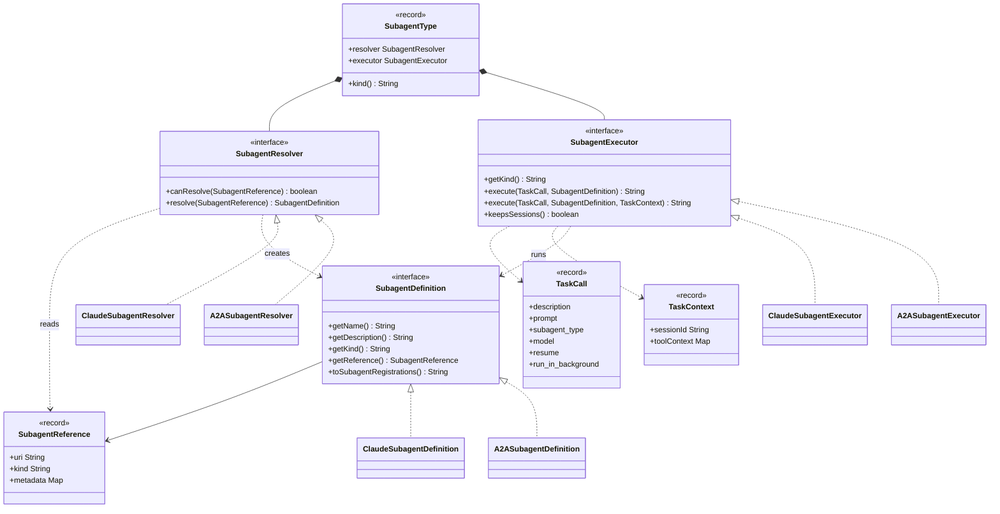
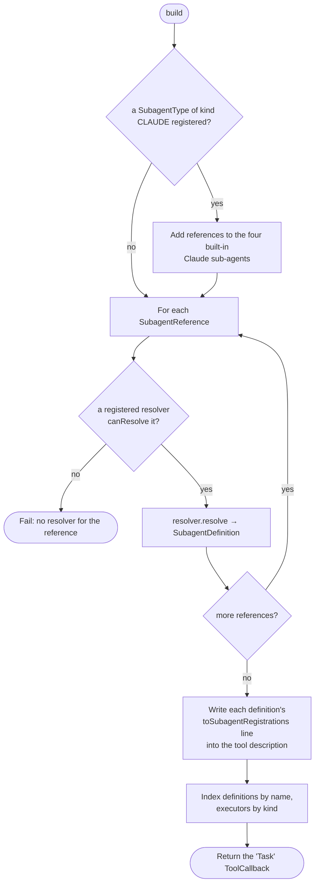
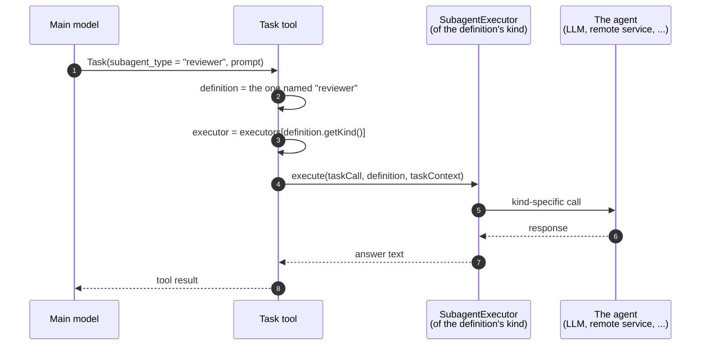

# Subagent Framework (SPI)

The `Task` tool does not know how any sub-agent works. It only knows a small set of interfaces, the **SPI**, and delegates everything else to the implementations registered with it. That is what lets one main agent use local Claude sub-agents, remote [A2A](https://google.github.io/A2A/) agents and agents of your own design side by side.

This page is for implementers who want to add a new **kind** of sub-agent. To use the existing ones, see the [Overview](TaskTools.md) and [Claude Sub-Agents](ClaudeSubagents.md).

The SPI lives in the `org.springaicommunity.agent.common.task.subagent` package of the [`spring-ai-agent-utils-common`](https://github.com/spring-ai-community/spring-ai-agent-utils/tree/main/spring-ai-agent-utils-common) module, so a new kind can live in its own module without depending on the others.

## The idea: finding an agent is separate from running it

Every kind of sub-agent answers two questions in its own way:

1. **What is this agent?** Read a Markdown file, fetch an A2A agent card, load an OpenAPI spec... That is the **resolver**'s job, and it happens once, when the `Task` tool is built.
2. **How do I give it a task?** Call a `ChatClient`, send a JSON-RPC message, make a REST call... That is the **executor**'s job, and it happens on every `Task` call.

A `SubagentType` pairs one resolver with one executor for a kind. A `SubagentReference` says where an agent is and which kind it is. The `Task` tool matches them up.

## The interfaces



The **kind** string (`"CLAUDE"`, `"A2A"`, ...) ties them together: a reference has a kind, a resolver accepts references of its kind, a definition reports its kind, and an executor runs definitions of its kind.

### SubagentReference

A pointer to an agent: where it is, and what kind it is.

```java
public record SubagentReference(String uri, String kind, Map<String, String> metadata) {
    public SubagentReference(String uri, String kind) { this(uri, kind, Map.of()); }
}
```

```java
new SubagentReference("classpath:/agents/explorer.md", "CLAUDE");                // a Claude Markdown file
new SubagentReference("http://agent.example.com:10001/myagent", "A2A");           // a remote A2A agent
new SubagentReference("grpc://agents.internal:443/analyzer", "CUSTOM",
        Map.of("auth", "mtls", "timeout", "30s"));                                 // kind-specific metadata
```

### SubagentResolver

Turns a reference into a definition. `canResolve` says whether the reference is of this resolver's kind.

```java
public interface SubagentResolver {
    boolean canResolve(SubagentReference subagentRef);
    SubagentDefinition resolve(SubagentReference subagentRef);
}
```

### SubagentDefinition

A resolved agent. The `Task` tool needs its name, description and kind; the rest is up to the kind (a system prompt, an agent card, an endpoint...).

```java
public interface SubagentDefinition {
    String getName();                     // what the model passes as subagent_type
    String getDescription();              // shown to the model in the Task tool's description
    String getKind();
    SubagentReference getReference();

    default String toSubagentRegistrations() {     // its line in the Task tool's description
        return "-%s: /%s".formatted(getName(), getDescription());
    }
}
```

### SubagentExecutor

Runs a task on a definition of its kind and returns the answer as text.

```java
public interface SubagentExecutor {
    String getKind();

    String execute(TaskCall taskCall, SubagentDefinition subagent);

    default String execute(TaskCall taskCall, SubagentDefinition subagent, TaskContext context) {
        return execute(taskCall, subagent);
    }

    default boolean keepsSessions() {
        return false;
    }
}
```

The `Task` tool always calls the three-argument `execute`. Its default calls the two-argument one, so a simple executor implements only that.

`TaskContext` carries what the `Task` tool knows beyond the call:

- `sessionId()`: the sub-agent's own session when [sub-agent memory](SubagentMemory.md) is on, otherwise `null`.
- `toolContext()`: the calling request's tool context.

An executor that can keep the sub-agent's transcript in that session overrides the three-argument method and returns `true` from `keepsSessions()`. The `Task` tool creates a session and returns an agent ID only for such executors. `ClaudeSubagentExecutor` does this when it has a session service.

### SubagentType

The unit you register with `TaskTool.builder().subagentTypes(...)`:

```java
public record SubagentType(SubagentResolver resolver, SubagentExecutor executor) {
    public String kind() { return executor.getKind(); }
}
```

### TaskCall

The `Task` tool's arguments, passed through to the executor unchanged. See [the parameters](TaskTools.md#the-task-tools-parameters).

```java
public record TaskCall(String description, String prompt, String subagent_type,
        String model, String resume, Boolean run_in_background) {}
```

## How the `Task` tool uses them

### When it is built

`TaskTool.builder().build()` resolves every reference up front:



The first resolver that accepts a reference wins. Since everything is resolved here, a missing file, an unreachable A2A agent or two sub-agents with the same name fail at startup.

### On every call



An unknown `subagent_type`, or a definition whose kind has no executor, fails the call.

## Writing a new kind

Implement the three interfaces and register them as a `SubagentType`.

**1. The definition** wraps what your kind knows about an agent:

```java
public class MySubagentDefinition implements SubagentDefinition {

    public static final String KIND = "MY_PROTOCOL";

    private final SubagentReference reference;
    private final MyAgentMetadata metadata;

    public MySubagentDefinition(SubagentReference reference, MyAgentMetadata metadata) {
        this.reference = reference;
        this.metadata = metadata;
    }

    @Override public String getName() { return metadata.name(); }
    @Override public String getDescription() { return metadata.description(); }
    @Override public String getKind() { return KIND; }
    @Override public SubagentReference getReference() { return reference; }

    public MyAgentMetadata getMetadata() { return metadata; }   // kind-specific
}
```

**2. The resolver** finds the agent's metadata:

```java
public class MySubagentResolver implements SubagentResolver {

    @Override
    public boolean canResolve(SubagentReference ref) {
        return MySubagentDefinition.KIND.equals(ref.kind());
    }

    @Override
    public SubagentDefinition resolve(SubagentReference ref) {
        try {
            return new MySubagentDefinition(ref, fetchMetadata(ref.uri()));
        }
        catch (IOException ex) {
            throw new IllegalStateException("Failed to resolve sub-agent " + ref.uri(), ex);
        }
    }
}
```

**3. The executor** sends the task:

```java
public class MySubagentExecutor implements SubagentExecutor {

    @Override
    public String getKind() { return MySubagentDefinition.KIND; }

    @Override
    public String execute(TaskCall taskCall, SubagentDefinition subagent) {
        MySubagentDefinition agent = (MySubagentDefinition) subagent;
        return myClient.send(agent.getMetadata(), taskCall.prompt());
    }
}
```

**4. Register it:**

```java
TaskTool.builder()
    .subagentTypes(new SubagentType(new MySubagentResolver(), new MySubagentExecutor()))
    .subagentReferences(new SubagentReference("my://agent-1", MySubagentDefinition.KIND))
    .build();
```

### Tips

- **Use a meaningful kind**: `"A2A"`, not `"type1"`. It shows up in logs and errors.
- **Fail clearly in `resolve`**: name the reference in the exception. It runs at startup, where a clear message saves time.
- **Bound remote calls in `execute`** with a timeout. The main agent waits for the answer, unless the call runs in the background.
- **Return errors as text when the model can act on them** ("agent unavailable, try later"), and throw only when it cannot.
- **Keep the executor stateless, or thread-safe**: the `Task` tool may call it from several threads, for parallel and background tasks.

## Existing kinds

| Kind | Module | Definition comes from | Executor | Memory |
|------|--------|-----------------------|----------|--------|
| `CLAUDE` | `spring-ai-agent-utils` | a Markdown file with YAML front matter | Spring AI `ChatClient`, with tool filtering, model routing and preloaded skills | yes, with a session service |
| `A2A` | `spring-ai-agent-utils-a2a` | the agent card at `/.well-known/agent-card.json` | A2A JSON-RPC message; the text of the returned artifacts | no |

Register the A2A kind next to the Claude one:

```java
import org.springaicommunity.agent.subagent.a2a.A2ASubagentDefinition;
import org.springaicommunity.agent.subagent.a2a.A2ASubagentExecutor;
import org.springaicommunity.agent.subagent.a2a.A2ASubagentResolver;

TaskTool.builder()
    .subagentTypes(ClaudeSubagentType.builder()
        .chatClientBuilder("default", chatClientBuilder.clone())
        .build())
    .subagentTypes(new SubagentType(new A2ASubagentResolver(), new A2ASubagentExecutor()))
    .subagentReferences(new SubagentReference("http://localhost:10001/myagent", A2ASubagentDefinition.KIND))
    .build();
```

See the [A2A module README](https://github.com/spring-ai-community/spring-ai-agent-utils/tree/main/spring-ai-agent-utils-a2a) and the [subagent-a2a-demo](https://github.com/spring-ai-community/spring-ai-agent-utils/tree/main/examples/subagent-a2a-demo).

Other protocols fit the same shape. An `MCP` kind could resolve agents from an `mcp.json` and execute through MCP tool calls; an `HTTP` kind could resolve from an OpenAPI spec and execute through REST calls.

## Package structure

```text
spring-ai-agent-utils-common/
  org.springaicommunity.agent.common.task.subagent
  ├── SubagentDefinition.java
  ├── SubagentReference.java
  ├── SubagentResolver.java
  ├── SubagentExecutor.java
  ├── SubagentType.java
  ├── TaskCall.java
  └── TaskContext.java

spring-ai-agent-utils/
  org.springaicommunity.agent.tools.task
  ├── TaskTool.java                    # the "Task" tool
  ├── TaskOutputTool.java              # the "TaskOutput" tool
  ├── SubagentSessions.java            # sub-agent memory: session layout
  ├── claude/
  │   ├── ClaudeSubagentDefinition.java
  │   ├── ClaudeSubagentResolver.java
  │   ├── ClaudeSubagentExecutor.java
  │   ├── ClaudeSubagentReferences.java
  │   └── ClaudeSubagentType.java      # builder for the CLAUDE SubagentType
  └── repository/
      ├── TaskRepository.java
      ├── DefaultTaskRepository.java
      └── BackgroundTask.java

spring-ai-agent-utils-a2a/
  org.springaicommunity.agent.subagent.a2a
  ├── A2ASubagentDefinition.java
  ├── A2ASubagentResolver.java
  └── A2ASubagentExecutor.java
```

## Related documentation

- [Overview](TaskTools.md), [Claude Sub-Agents](ClaudeSubagents.md), [Background Tasks](BackgroundTasks.md), [Sub-Agent Memory](SubagentMemory.md)
- [A2A protocol](https://google.github.io/A2A/), [MCP](https://modelcontextprotocol.io/)
