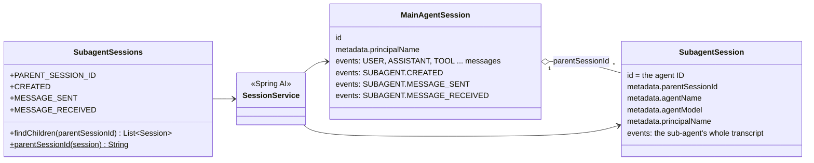
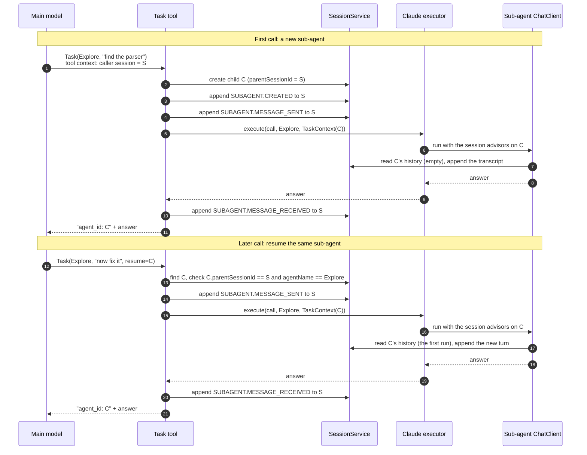
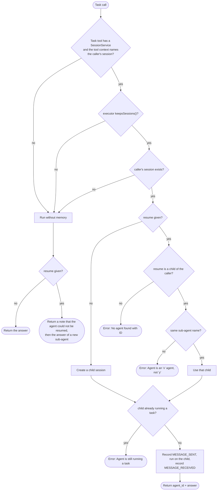

# Sub-Agent Memory

Without memory, every `Task` call starts a brand-new sub-agent, and everything it learned is lost when it answers. With memory, each sub-agent keeps its transcript in a **session** of its own. The main agent gets an **agent ID** back and can pass it as `resume` to continue the same sub-agent later, with all its earlier work in context:

> **Main agent:** Task(Explore, "find where the parser handles escapes") → `agent_id: 7c1e...` + findings
> **Main agent:** Task(Explore, "now check the tests for those methods", resume=`7c1e...`) → the sub-agent already knows which methods

Memory is built on Spring AI's [session module](https://docs.spring.io/spring-ai/reference/api/session.html) and is off unless you turn it on. For how delegation works in general, see the [Overview](TaskTools.md).

## Turning it on

You need `spring-ai-session` and `spring-ai-session-advisor` on the classpath; this library declares both as optional dependencies. Then give **one** `SessionService` to three places:

```java
SessionService sessionService = DefaultSessionService.builder()
    .sessionRepository(InMemorySessionRepository.builder().build()) // or the JDBC repository
    .build();

ToolCallback taskTool = TaskTool.builder()
    .sessionService(sessionService)                               // 1. the Task tool
    .subagentTypes(ClaudeSubagentType.builder()
        .chatClientBuilder("default", chatClientBuilder.clone())
        .sessionService(sessionService)                           // 2. the sub-agent kind
        .build())
    .build();

ChatClient chatClient = chatClientBuilder
    .defaultTools(taskTool)
    .defaultAdvisors(SessionAdvisors.builder(sessionService)      // 3. the main agent's session
        .sessionIdInToolContext(true)
        .build())
    .build();

chatClient.prompt("Review the parser, then fix what the reviewer finds")
    .advisors(SessionAdvisors.session(sessionId))
    .call()
    .content();
```

| Where | Why |
|-------|-----|
| `TaskTool.builder().sessionService(...)` | The `Task` tool creates the sub-agents' sessions and records the exchanges. |
| `ClaudeSubagentType.builder().sessionService(...)` | The Claude executor keeps each sub-agent's transcript in its session. To choose the advisors that do it, use [`sessionAdvisors(...)`](#choosing-the-sub-agents-session-advisors) instead. |
| `SessionAdvisors...sessionIdInToolContext(true)` on the main agent | Puts the main agent's session ID into the tool context, where the `Task` tool finds it. Without it the `Task` tool does not know whose sub-agent this is. |

If any of the three is missing, sub-agents run without memory, exactly as before. Nothing fails.

## How the sessions are laid out

Each sub-agent gets a **child session** of the session of the agent that called it. The child keeps the sub-agent's conversation. The caller's session gets a few events that say which child did what.



**The child session** carries this metadata:

| Key | Value |
|-----|-------|
| `parentSessionId` (`SubagentSessions.PARENT_SESSION_ID`) | The caller's session ID |
| `agentName` (`SessionAttributes.AGENT_NAME`) | The sub-agent's name, for example `Explore` |
| `agentModel` (`SessionAttributes.AGENT_MODEL`) | The `model` from the sub-agent's definition, when it has one |
| `principalName` (`SessionAttributes.PRINCIPAL_NAME`) | Copied from the caller's session, when set |

It gets the session service's normal time to live. Its ID is the **agent ID** the main model sees.

**The caller's session** gets these events. They are not message events, so they never appear in the caller's prompt. They link the caller's `Task` call (whose arguments and result the caller's log already holds) to the child:

| Event type | When | Payload |
|------------|------|---------|
| `SUBAGENT.CREATED` | A new child was created | `sessionId`, `agentName`, `agentModel` (when known) |
| `SUBAGENT.MESSAGE_SENT` | A task was sent to the child | `sessionId`, `agentName` |
| `SUBAGENT.MESSAGE_RECEIVED` | The child answered, or failed | `sessionId`, `agentName`, `error` (only when it failed) |

## What happens on a call

The first call creates a child; a later call with `resume` continues it.



Only the sub-agent's final answer goes back to the main model. Its tool calls stay in the child's log.

Inside the sub-agent, the child session is also the session its own tools see. A sub-agent that has a `Task` tool of its own creates *its* children under the child, so the sessions form a tree.

## How the `Task` tool decides



The errors go back to the model as the tool result, so it can correct itself:

| Result | Cause |
|--------|-------|
| `Error: No agent found with ID: <id>` | `resume` is not a sub-agent of the calling session: a typo, an expired session, or another agent's child. |
| `Error: Agent <id> is a '<a>' agent, not '<b>'` | `resume` belongs to a different sub-agent than `subagent_type`. |
| `Error: Agent <id> is still running a task; wait for its result before resuming it` | The same sub-agent is busy, for example in the background. Two runs at once would mix their turns in one log. |
| `Note: agent <id> could not be resumed, because sub-agent memory is off; ...` | Memory is off for this call (see the "no" branches above). The task ran on a new sub-agent. |

A run that throws still records `SUBAGENT.MESSAGE_RECEIVED`, with the error, and the exception then propagates as usual. Background tasks (`run_in_background`) go through the same steps on their worker thread.

## Things to know

- **Listing a session's sub-agents.** `new SubagentSessions(sessionService).findChildren(sessionId)` returns the children, oldest first. It looks them up by metadata: the in-memory repository can do that for any key, but the JDBC repository only for the keys in its `indexedAttributes`. Add `SubagentSessions.PARENT_SESSION_ID` there to list children with JDBC. Resuming does not need the index.
- **Sub-agent transcripts are stored.** With memory on, everything a sub-agent reads or runs (file contents, command output, web pages) is saved in its session, for the session's time to live. Before, it was dropped when the sub-agent answered. Choose the repository and the time to live with that in mind.
- **Cross-session recall sees them.** A child inherits the caller's `principalName`, so sub-agent sessions are among the user's sessions that [Auto-Dream cross-session recall](AutoDreamService.md) searches.
- **Background threads.** A background task runs without the calling thread's thread-locals. If your `SessionService` checks the current user, give the `Task` tool a `TaskRepository` whose executor copies that context. See [Background Tasks](BackgroundTasks.md#defaulttaskrepository).

## Choosing the sub-agents' session advisors

`ClaudeSubagentType.builder().sessionService(...)` gives every sub-agent Spring AI's session advisors with their default settings. To choose the advisors yourself, pass them with `sessionAdvisors(...)` instead. For example, to compact long sub-agent transcripts:

```java
ClaudeSubagentType.builder()
    .chatClientBuilder("default", chatClientBuilder.clone())
    .sessionAdvisors(SessionAdvisors.builder(sessionService)
        .sessionIdInToolContext(true)          // keep this: a nested Task tool needs it
        .compaction(trigger, strategy)
        .build())
    .build();
```

Two rules:

- Build them on the same `SessionService` the `Task` tool has, and with `sessionIdInToolContext(true)`.
- Pass them here, not as default advisors of the sub-agents' `ChatClient.Builder`. These advisors are added only to a task that runs on a session. Session advisors on the builder fail every task that runs without memory, because there is no session ID.

## A tool call that needs confirmation

Spring AI can pause a tool call until a person confirms it (`ToolCallConfirmationPolicy`, `@Tool(requiresConfirmation = true)`). A sub-agent has nobody to ask. When one of its calls needs confirmation, the task ends there, none of the tool calls of that reply run, and the `Task` result says so:

```text
agent_id: 7c1e...

[The sub-agent stopped before it finished: its call to Bash needs a person's confirmation, and a sub-agent cannot ask for one. None of the 1 tool call(s) of its last reply ran. If you resume this agent, those calls are answered as not run and it goes on without their results.]
```

The main model can resume the sub-agent, or do that step itself. There is no way yet to pass a person's decision through the `Task` tool to the sub-agent. Spring AI asks for the tools marked `requiresConfirmation` by default. If your sub-agents must run such tools, give the sub-agents' `ChatClient.Builder` a `ToolCallingManager` whose policy does not ask for them, for example `ToolCallConfirmationPolicy.none()`.

## With the turn module of spring-ai-session-extensions

The [turn module](https://github.com/spring-ai-community/spring-ai-session-extensions) records whether a session is running a turn, and lets you interrupt it. This library does not depend on it, and the two work together:

- **On the main agent**, use `TurnAdvisors.builder(sessionService).sessionIdInToolContext(true).build()` in place of the session advisors. Nothing else changes: the `SUBAGENT.*` events are not messages and do not affect the turn status.
- **On the sub-agents**, pass the turn advisors with `sessionAdvisors(...)`:

    ```java
    ClaudeSubagentType.builder()
        .chatClientBuilder("default", chatClientBuilder.clone())
        .sessionAdvisors(TurnAdvisors.builder(sessionService).sessionIdInToolContext(true).build())
        .build();
    ```

    Each sub-agent session then has a turn status of its own. That adds two things:

    - A second application instance that resumes a sub-agent which is still running is refused with a `TurnInProgressException`. Without the turn advisors, the "still running" check only sees the tasks of its own instance.
    - `turnService.interrupt(childSessionId, reason)` stops a running sub-agent before its next model round.

What does not work yet:

- Interrupting the main agent's turn does not stop its sub-agents. Interrupt each child yourself; `SubagentSessions.findChildren(sessionId)` lists them.
- A sub-agent that waits for a confirmation is parked with its question in its session (`TURN.QUESTION`), but the `Task` tool cannot deliver the answer. Resuming it counts the calls as denied.
- Each sub-agent turn gets a run ID of its own, not the run ID of the main agent's turn.

**Background sub-agents and the turn status.** The turn module writes every status change (start, end, park, interrupt) against the version of the session's log, and repeats the write when another event was appended in between. After five lost attempts it throws an `IllegalStateException`. A `SUBAGENT.*` event is such an append. For a foreground `Task` call this never matters, because its events are written inside the running turn. A background sub-agent records `SUBAGENT.MESSAGE_RECEIVED` on the caller's session whenever it finishes, which can cost the caller's next status change a retry. It only fails when five appends in a row hit the same status change, for example many background sub-agents that finish at the same moment.

## Memory for other kinds of sub-agent

The Claude executor keeps sessions once its `ClaudeSubagentType` has a session service or session advisors. An executor of another kind opts in like this:

1. Return `true` from `SubagentExecutor.keepsSessions()`.
2. Override `execute(TaskCall, SubagentDefinition, TaskContext)` and keep the sub-agent's transcript in the session named by `context.sessionId()`.

Executors that do not opt in, such as the A2A executor, run without memory: the `Task` tool creates no session for them and returns no agent ID. See [Subagent Framework (SPI)](Subagent.md#subagentexecutor).
