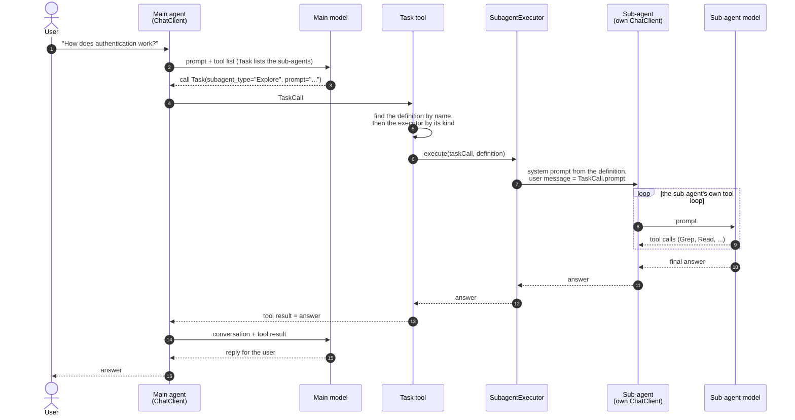
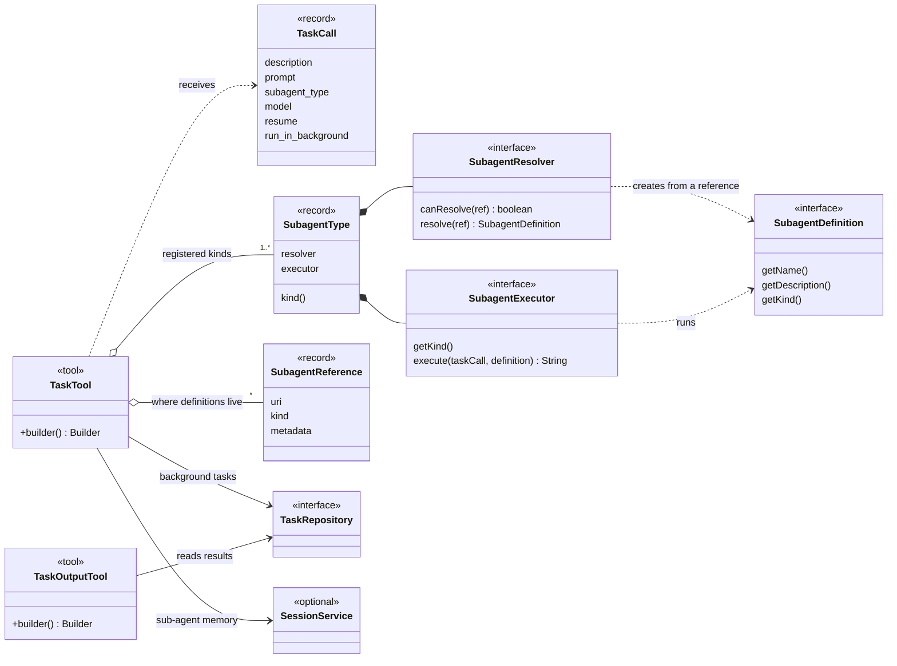

# Sub-Agents: Overview

The `Task` tool lets your main agent hand a piece of work to a **sub-agent**: another agent with its own system prompt, its own tools and its own context window. The sub-agent works on the task alone and returns one answer. The main agent sees only that answer, not the many tool calls that produced it.

The design follows [Claude Code's sub-agents](https://code.claude.com/docs/en/sub-agents). It is extensible: sub-agents can be local LLM agents defined in Markdown (the built-in **Claude** kind), remote agents reached over [A2A](https://google.github.io/A2A/), or a kind you write yourself.

This section has five pages:

| Page | Read it to |
|------|------------|
| **Overview** (this page) | understand how delegation works and get a first agent running |
| [Claude Sub-Agents](ClaudeSubagents.md) | use the built-in sub-agents, write your own in Markdown, pick their tools and models |
| [Background Tasks](BackgroundTasks.md) | run sub-agents asynchronously and collect their results with `TaskOutput` |
| [Sub-Agent Memory](SubagentMemory.md) | let a sub-agent keep its context so the main agent can resume it |
| [Subagent Framework (SPI)](Subagent.md) | plug in a new kind of sub-agent (A2A, MCP, HTTP, ...) |

## Why use sub-agents

| Benefit | What it means |
|---------|---------------|
| **Smaller main context** | Searching a codebase can take dozens of tool calls. A sub-agent makes them in its own context and hands back a summary, so the main conversation stays short and on topic. |
| **Specialists** | Each sub-agent has a prompt written for one job (exploring, planning, reviewing, running commands). |
| **Least privilege** | Each sub-agent gets only the tools its job needs. An explorer does not need `Write`. |
| **Right model for the job** | Route quick searches to a small, cheap model and hard analysis to a large one, even to a different provider. |
| **Parallel and background work** | The main agent can start several sub-agents in one turn, or start one in the background and keep working. |

## How a delegation works

The main agent decides to delegate the way it decides to call any other tool: the `Task` tool's description lists the sub-agents and what each is for, and the model picks one.



In plain words:

1. The model calls the `Task` tool with a short `description`, a `prompt` and the `subagent_type` (the sub-agent's name).
2. The tool looks up that sub-agent's **definition** and the **executor** registered for its kind.
3. The executor runs the sub-agent. A Claude sub-agent is a fresh `ChatClient` with the definition's system prompt and tools. Its whole tool loop happens inside this one `Task` call.
4. Only the sub-agent's final answer comes back, as the `Task` tool's result. The main model reads it and carries on.

A sub-agent starts with an empty context: it sees its system prompt and the `prompt` the main model wrote, not the main conversation. The main model should therefore put everything the sub-agent needs into that prompt. With [Sub-Agent Memory](SubagentMemory.md), the main agent can also *resume* a sub-agent it used before.

## The building blocks



| Piece | Role |
|-------|------|
| `TaskTool` | Builds the `Task` tool. You register sub-agent kinds and references on its builder. |
| `SubagentReference` | Where a sub-agent definition lives (a file, a classpath resource, a URL) and its kind (`CLAUDE`, `A2A`, ...). |
| `SubagentType` | One kind of sub-agent: a **resolver** that turns references into definitions, and an **executor** that runs them. |
| `SubagentDefinition` | A resolved sub-agent: name, description, kind, plus whatever its kind needs (prompt, tools, model, agent card ...). |
| `TaskCall` | The arguments the model passes to the `Task` tool. |
| `TaskOutputTool`, `TaskRepository` | Run sub-agents in the background and fetch their results. See [Background Tasks](BackgroundTasks.md). |
| `SessionService` (optional) | Keeps each sub-agent's transcript so it can be resumed. See [Sub-Agent Memory](SubagentMemory.md). |

The interfaces (`SubagentReference`, `SubagentType`, `SubagentResolver`, `SubagentDefinition`, `SubagentExecutor`, `TaskCall`) live in the `spring-ai-agent-utils-common` module, so a new kind can be built in its own module. The modules are:

| Module | Contains |
|--------|----------|
| `spring-ai-agent-utils-common` | The SPI: `SubagentDefinition`, `SubagentReference`, `SubagentResolver`, `SubagentExecutor`, `SubagentType`, `TaskCall`, `TaskContext` |
| `spring-ai-agent-utils` | `TaskTool`, `TaskOutputTool`, the task repository, sub-agent memory, and the Claude kind (`ClaudeSubagentType`, ...) |
| `spring-ai-agent-utils-a2a` | The A2A kind (optional dependency) |

## Quick start

Register the Claude kind with a `ChatClient.Builder` and give the `Task` tool to your main agent. The four [built-in sub-agents](ClaudeSubagents.md#built-in-sub-agents) (`general-purpose`, `Explore`, `Plan`, `Bash`) are added automatically.

```java
import org.springaicommunity.agent.tools.task.TaskTool;
import org.springaicommunity.agent.tools.task.claude.ClaudeSubagentType;

@Bean
CommandLineRunner demo(ChatClient.Builder chatClientBuilder) {
    return args -> {
        ToolCallback taskTool = TaskTool.builder()
            .subagentTypes(ClaudeSubagentType.builder()
                // A copy: sub-agents must not inherit the main agent's tools and advisors
                .chatClientBuilder("default", chatClientBuilder.clone())
                .build())
            .build();

        ChatClient chatClient = chatClientBuilder
            .defaultToolCallbacks(taskTool)
            .build();

        String answer = chatClient
            .prompt("Explore the authentication module and explain how it works")
            .call()
            .content();
    };
}
```

!!! warning "Clone the builder you give to sub-agents"
    `ChatClient.Builder` is mutable, and the Claude executor copies its builder each time a sub-agent runs. If you pass the main agent's builder itself, everything you add to it later (`defaultToolCallbacks(taskTool)`, advisors, ...) also reaches every sub-agent, including the `Task` tool itself. Pass `chatClientBuilder.clone()`.

To add your own sub-agents, write them as Markdown files and register them with `.subagentReferences(...)`. See [Claude Sub-Agents](ClaudeSubagents.md#writing-your-own-sub-agent).

## The `Task` tool's parameters

The model fills these in. They are the fields of the `TaskCall` record.

| Parameter | Required | Meaning |
|-----------|----------|---------|
| `description` | yes | A 3 to 5 word summary of the task. |
| `prompt` | yes | The task itself. It is the sub-agent's only input, so it must be self-contained. |
| `subagent_type` | yes | The name of the sub-agent to run. An unknown name fails the call. |
| `resume` | no | The agent ID of a sub-agent to continue. Works only with [Sub-Agent Memory](SubagentMemory.md); without it the task runs on a new sub-agent and the answer says so. |
| `run_in_background` | no | `true` returns a `task_id` at once and runs the sub-agent on another thread. See [Background Tasks](BackgroundTasks.md). |
| `model` | no | Declared for compatibility with Claude Code, but the built-in executors ignore it: the model comes from the sub-agent's definition. See [model routing](ClaudeSubagents.md#choosing-the-model). |

What the tool returns:

| Situation | Result |
|-----------|--------|
| Normal run | The sub-agent's answer. |
| With sub-agent memory | `agent_id: <id>`, a blank line, then the answer. |
| `run_in_background: true` | `task_id: <id>` and a hint to call `TaskOutput`. |

## Usage patterns

**Automatic delegation.** The main model picks a sub-agent from the descriptions in the `Task` tool:

```java
chatClient.prompt("How does authentication work in this codebase?").call().content();
// the model will usually delegate this to the Explore sub-agent
```

**Explicit delegation.** Name the sub-agent in the request:

```java
chatClient.prompt("Use the code-reviewer subagent to review my recent changes").call().content();
```

**Parallel delegation.** The `Task` tool's description tells the model to start independent sub-agents in one turn, with several `Task` calls in a single message. Whether they then run at the same time depends on how your `ChatClient` executes tool calls.

**Background delegation.** Ask for it ("run the tests in the background") and wire the `TaskOutput` tool. See [Background Tasks](BackgroundTasks.md).

## `TaskTool` builder

```java
TaskTool.builder()
    .subagentTypes(SubagentType...)               // at least one kind (required)
    .subagentReferences(SubagentReference...)     // your own sub-agents, of any registered kind
    .taskRepository(TaskRepository)               // background tasks (default: new DefaultTaskRepository())
    .sessionService(SessionService)               // sub-agent memory (default: none)
    .taskDescriptionTemplate(String)              // the tool description; %s receives the sub-agent list
    .build();                                     // returns the "Task" ToolCallback
```

`build()` resolves every reference at once, so a missing file or an unknown kind fails at startup, not at the first call. When the Claude kind is registered it also adds the four built-in sub-agents.

## Related documentation

- [Claude Sub-Agents](ClaudeSubagents.md), [Background Tasks](BackgroundTasks.md), [Sub-Agent Memory](SubagentMemory.md), [Subagent Framework (SPI)](Subagent.md)
- [FileSystemTools](FileSystemTools.md), [GrepTool](GrepTool.md), [GlobTool](GlobTool.md), [ShellTools](ShellTools.md): the tools Claude sub-agents use
- [SkillsTool](SkillsTool.md): skills you can preload into sub-agents
- [Example: subagent-demo](https://github.com/spring-ai-community/spring-ai-agent-utils/tree/main/examples/subagent-demo) and [subagent-a2a-demo](https://github.com/spring-ai-community/spring-ai-agent-utils/tree/main/examples/subagent-a2a-demo)
- [Claude Code sub-agents](https://code.claude.com/docs/en/sub-agents) and [Claude Agent SDK sub-agents](https://platform.claude.com/docs/en/agent-sdk/subagents)
